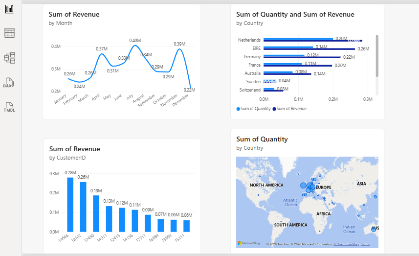

# Online Retail Dashboard (Power BI) – Tata Data Visualisation Simulation

## Overview

Power BI dashboard built for the Tata "Data Visualisation: Empowering Business with Effective Insights" job simulation on Forage (completed April 2026). The task was to answer business questions from a global online retailer's 2011 transactions, choosing the right visual for each question.

## Questions and visuals

| Question | Visual |
|---|---|
| How did monthly revenue change in 2011? | Line chart, revenue (Quantity × Unit Price) by month |
| Which countries (outside the UK) bring the most revenue and volume? | Side-by-side bar chart, revenue and quantity, top 10 countries, UK excluded |
| Who are the top customers by revenue? | Column chart, top 10 customers |
| Where is demand concentrated? | Map, quantity by country |

## Insights

- **Revenue is seasonal.** It is lowest in February (£0.24M), rises to £0.37M in April and peaks at £0.40M in July, with a second peak of £0.39M in November.
- **Outside the UK, the Netherlands and EIRE lead.** Netherlands brings about £0.28M of revenue and EIRE £0.26M, ahead of Germany (£0.22M) and France (£0.20M).
- **A few customers matter a lot.** The top customer brings £0.28M and the second £0.26M; revenue drops to about £0.06M by the tenth customer.
- **Demand is concentrated in Europe**, with smaller volumes in Australia and Asia.

## Skills shown

- Creating a calculated revenue column in Power BI
- Choosing a visual to match each business question
- Filtering (top N, excluding a country, a single year)

## Files

| File | Description |
|---|---|
| `dashboard.png` | Dashboard screenshot |
| `certificate.png` | Forage certificate of completion |
